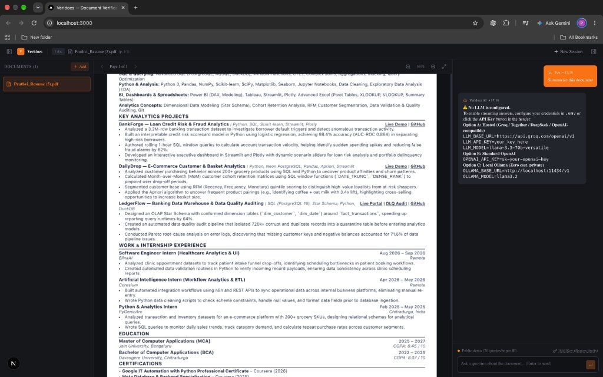

# 📑 Veridocs

Fast, honest, lightweight document question answering (RAG) with real page citations and claim grounding checks.

Runs entirely locally on an 8GB RAM laptop with **zero Docker required**.

---

## 🚀 Live Demo

- **Web Application**: [https://veridocs17.vercel.app](https://veridocs17.vercel.app)
- **FastAPI Backend**: [https://veridocs-backend.onrender.com](https://veridocs-backend.onrender.com)
- **API Documentation**: [https://veridocs-backend.onrender.com/docs](https://veridocs-backend.onrender.com/docs)

*(Hosted on free-tier Render & Vercel. Inactive instances spin down after 15 minutes of idle time; please allow ~20–30s on first load if the backend is waking up).*

---

## 📸 Preview



---

## What Actually Works

- **Real Document Ingestion**: Upload multi-page PDF or TXT documents. Documents are extracted with `pypdf`, chunked into granular ~600-character windows with 100-character overlap and section header boundary detection, and embedded locally using Fastembed ONNX (`bge-small-en-v1.5`).
- **Interactive PDF Viewer**: Built-in PDF.js canvas viewer rendering actual PDF bytes from the backend with fit-to-width default, zoom controls, and responsive centered alignment with zero left-edge clipping.
- **Granular Page Citations**: Citations format as clickable inline chips (`[1]`, `[2]`). Clicking a chip jumps directly to that page in the PDF viewer and displays a floating preview banner with the cited passage excerpt.
- **GFM Markdown Answers**: Full GitHub-Flavored Markdown support in streaming responses, cleanly formatting tables, code blocks, bulleted lists, and bold text without conversational fluff or closing recap lines.
- **Conversational Memory & Follow-up Rewriting**: Retains recent conversational turns. Follow-up questions referencing previous answers are rewritten into standalone vector search queries before retrieval.
- **Small-Talk Bypass**: Conversational pleasantries ("ok thanks", "hi", "thank you") bypass vector search and citation checks entirely, returning immediate friendly responses.
- **Honest Citation Check**: Verifies whether factual answer claims are supported by retrieved excerpts using an n-gram overlap check. Includes safe sentence splitting that protects numbered lists (`1.`) and abbreviations (`e.g.`, `i.e.`). Intro sentences, meta-statements, and missing-data replies are automatically excluded from scoring.
- **Universal OpenAI-Compatible LLM + BYOK**: Driven by standard `LLM_BASE_URL`, `LLM_API_KEY`, and `LLM_MODEL` (supporting Groq, Together, DeepSeek, OpenAI, or local Ollama). Visitors can also click **Add Key (Bypass limits)** in the UI to paste their own key directly into the browser, stored locally only.
- **Abuse Protection**: In-memory per-IP rate limiting (20 queries/hr, 10 uploads/hr), 10 MB maximum upload size, 50-page document limit, and 20 active sessions maximum.
- **Durable Local Storage**: Chunks and L2-normalized float32 vectors are stored in SQLite (`backend/data/veridocs.db`). No Postgres, pgvector, Redis, or Celery.

---

## Quickstart

Tested from a fresh clone. Requires **Python 3.10+** and **Node.js 18+**.

### 1. Clone the Repository

```bash
git clone https://github.com/Spidey173/Veridocs.git
cd Veridocs
```

### 2. Configure Environment

Copy the example environment template:

```bash
cp .env.example .env
```

*(Optional: Open `.env` and add your Groq or OpenAI API key. If left blank, document indexing, vector search, and the PDF viewer work completely. You can also paste your API key directly in the chat panel via the **Add Key (Bypass limits)** button).*

### 3. Launch the Application

#### Option A: One-Command Start (Recommended)

Run the automated startup script:

```bash
./run.sh
```
*(Or use `npm run dev`). This script automatically verifies `.venv`, installs `requirements.txt`, installs `node_modules`, and concurrently boots both the FastAPI backend (port 8000) and Next.js frontend (port 3000).*

#### Option B: Manual Setup (Separate Terminals)

If you prefer running services in separate terminal windows:

```bash
# 1. Setup Python backend
python3 -m venv .venv
source .venv/bin/activate
pip install -r requirements.txt

# 2. Setup Node frontend
npm install

# Terminal 1: Backend
uvicorn backend.main:app --host 0.0.0.0 --port 8000 --reload --reload-dir backend

# Terminal 2: Frontend
npm run dev:frontend
```

### 4. Access the App

- **Web Application**: [http://localhost:3000](http://localhost:3000)
- **FastAPI Swagger Docs**: [http://localhost:8000/docs](http://localhost:8000/docs)

---

## Performance & Memory Benchmarks

Measured on macOS (Apple Silicon, 8GB RAM baseline) on the bundled **6-page sample agreement** (12 passage chunks):

| Metric | Measured Value | Notes |
| :--- | :--- | :--- |
| **RAM Usage (Idle)** | **~302 MB** | Baseline Python runtime + loaded Fastembed ONNX session |
| **RAM Usage (Peak Querying)** | **~311 MB** | Fully stable under 500 MB (runs easily on 8GB laptops) |
| **Fastembed Model Download** | **~133 MB** | One-time download on first cold run, cached locally |
| **Model Init from Disk Cache** | **~360 ms** | Once cached, loads locally in under half a second |
| **6-Page PDF Ingestion & Embed** | **~207 ms** | ~17.2 ms per passage chunk |
| **Vector Retrieval Latency** | **~3.4 ms** | SQLite scan + NumPy dot product cosine similarity on the 6-page sample |
| **Citation Check Latency** | **~0.3 ms** | N-gram claim overlap analysis |

---

## Architecture

```
Veridocs/
├── app/                  # Next.js App Router (layout, page, theme)
├── components/           # React UI components
│   ├── chat/             # ChatPanel, CitationBadge, VerificationDrawer
│   ├── pdf-viewer/       # PDFViewer canvas with fit-to-width & jump-to-page
│   ├── upload/           # DropZone document upload
│   └── workspace/        # WorkspaceLayout, Header, FileManager
├── lib/                  # Zustand store and honest API client
├── public/               # Sample contract, icons, static assets
├── tests/                # Frontend Vitest test suite (11 tests)
├── backend/
│   ├── main.py           # FastAPI entrypoint, lifespan & CORS
│   ├── database.py       # SQLite chunk & vector persistence + TTL cleanup
│   ├── vector_store.py   # Vector retrieval with NumPy dot product
│   ├── llm_service.py    # OpenAI-compatible streaming client
│   ├── pdf_processor.py  # pypdf text extraction, smart chunking & sample generator
│   ├── verification.py   # N-gram citation claim check & sentence splitter
│   ├── rate_limiter.py   # Per-IP sliding window abuse protection
│   ├── config.py         # App configuration & Fastembed model registry
│   ├── Dockerfile        # Production multi-stage Docker build
│   └── tests/            # 22 backend behavior pytest tests
├── requirements.txt      # Unified Python dependencies (used by local, Docker, Render)
├── run.sh                # One-command development startup script
├── package.json          # Single package.json for frontend, test & dev orchestration
└── scripts/
    ├── dev.js            # Starts FastAPI and Next.js concurrently (npm run dev)
    └── dev/              # Development testing and verification tools
        ├── README.md
        └── test_resume_qa.py # Multi-turn resume QA test script
```

---

## Verification & Tests

### Run Full Test Suite (Frontend + Backend)

```bash
npm test
```

- **Frontend (Vitest)**: 11 tests passing (~400ms)
- **Backend (Pytest)**: 22 tests passing (~1.8s)

### Production Build

```bash
npm run build
```

*Result: Compiled successfully with zero TypeScript or webpack errors in ~2.5s.*

---

## Deployment & Environment Variables

### 1. Backend on Render (Web Service)
- **Runtime**: Docker (points to `backend/Dockerfile`, context `.`).
- **Build**: Fastembed ONNX weights (`bge-small-en-v1.5`) are pre-downloaded during Docker build so the image boots immediately without downloading weights at runtime.
- **Environment Variables**:
  | Variable | Value | Description |
  | :--- | :--- | :--- |
  | `FRONTEND_ORIGIN` | `https://veridocs17.vercel.app` | Allowed CORS origin (also auto-allows `*.vercel.app` previews) |
  | `LLM_BASE_URL` | `https://api.groq.com/openai/v1` | OpenAI-compatible API endpoint |
  | `LLM_API_KEY` | `gsk_...` | API key for LLM |
  | `LLM_MODEL` | `openai/gpt-oss-120b` | Model identifier |
  | `RATE_LIMIT_QUERY_PER_HOUR` | `20` | Max queries/hour per IP (BYOK users bypass this limit) |
  | `MAX_FILE_SIZE_MB` | `10` | Max upload size in megabytes |

### 2. Frontend on Vercel
- **Framework**: Next.js (Root Directory: `.`).
- **Environment Variables**:
  | Variable | Value | Description |
  | :--- | :--- | :--- |
  | `NEXT_PUBLIC_API_URL` | `https://veridocs-backend.onrender.com` | Render backend URL |

---

## Known Limitations

1. **Ephemeral Storage on Render Free Tier**: Render's free tier uses an ephemeral filesystem. On container restarts or after spinning down from inactivity (~15 minutes idle), custom uploaded documents reset. The bundled 6-page `sample_agreement.pdf` is automatically re-indexed on boot for showcase testing.
2. **Cold Starts on Free Hosting**: Free-tier Render instances spin down when idle. Cold starts take **20–30 seconds** to wake up the container. The frontend detects this and displays a notification banner while polling for health.
3. **Single-User Workspace**: Veridocs is designed for focused document inspection and local execution; it does not include multi-tenant organization management or document RBAC.
4. **Citation Check Scope**: The citation check is an **n-gram text overlap heuristic** verifying whether answer claims literally appear in the retrieved context chunks. It is not an expensive multi-judge LLM evaluation model.

---

## License

MIT
