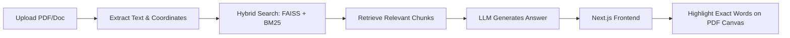

<div align="center">

# 📑 Veridocs

**Smart Document QA & Comparison with Visual Source Highlighting**

[](https://python.org)
[](https://fastapi.tiangolo.com)
[](https://nextjs.org)
[-success?style=flat-square&logo=pytest&logoColor=white)](https://github.com/Spidey173/Veridocs)
[](LICENSE)

<br />

[Why I Built This](#-why-i-built-this) • [Key Features](#-key-features) • [How to Explain in an Interview](#-how-to-explain-this-in-an-interview) • [Architecture](#-how-it-works-architecture) • [Tech Stack](#️-tech-stack) • [Quick Start](#-quick-start) • [Testing](#-testing)

</div>

---

## 💡 Quick Overview (For Recruiters & Interviewers)

> **Role Focus:** **Junior Full-Stack Engineer / Python Backend / AI Application Developer**  
> **What This Is:** A full-stack web application that lets users upload PDFs, ask questions, see exact answers **highlighted directly on the document page**, and **compare two documents** side-by-side to catch discrepancies (like changed prices, dates, or clauses).

### ⚡ 3 Standout Engineering Highlights
1. **Visual Source Grounding:** When the AI gives an answer, clicking the citation scrolls the PDF and draws a visual highlight box over the exact sentence on the page using PDF.js.
2. **Hybrid Search on CPU:** Combines keyword search (BM25 for exact terms/IDs) with vector search (FAISS for meaning) using FastEmbed ONNX (~70MB RAM, no heavy GPU needed).
3. **82 Automated Tests:** 100% passing test suite running in **under 1 second** using Pytest with mocked APIs for reliable offline testing.

---

## 🎯 Why I Built This

Most generic "Chat with your PDF" tutorials have two big problems:
1. **You can't verify where answers come from:** The AI gives you a block of text, but you don't know if it hallucinated or what page the information is on.
2. **You can't compare documents:** In real life (contracts, invoices, policy updates), people need to compare **Version 1 vs Version 2** to see what changed.

I built **Veridocs** to solve these two practical problems with a clean full-stack interface.

---

## ✨ Key Features

### 1. 🔍 Visual PDF Highlighting
- When you ask a question, the backend retrieves the relevant text chunk and its page location.
- The frontend (using PDF.js) finds the matching text on that page and draws a colored highlight box around it.
- Clicking any citation automatically scrolls you to that exact spot on the document.

### 2. ⚖️ Side-by-Side Document Comparison
- Upload two versions of a document (e.g., an original contract and an amended contract).
- The system checks both files and flags differences—such as changes in payment terms, liability numbers, or dates.
- You can click **"Inspect in Canvas"** to jump to the clause in Document A or Document B.

### 3. 🔎 Hybrid Search (Keywords + Meaning)
- **Keyword Search (BM25):** Great for finding exact numbers, section codes (e.g., "Section 4.2"), or names.
- **Vector Search (FAISS):** Great for finding concepts even if you use different words.
- Both results are combined so you get the best of both worlds.

### 4. 🛡️ Fact-Checking & Hallucination Check
- Verifies that numbers, dates, and amounts in the AI's answer actually appear in the uploaded document.
- Tags answers with simple status badges so you know if a statement is directly backed by the source text.

### 5. ⚡ Lightweight & Fast
- Uses **FastEmbed ONNX** instead of heavy PyTorch libraries.
- Runs smoothly on standard CPU instances using just **~70MB of RAM** (instead of 2GB+).

---

## 🗣️ How to Explain This in an Interview

*(Clear, honest, and easy to speak out loud without getting trapped in complex math!)*

### The 30-Second Pitch
> *"I built Veridocs because standard 'Chat with PDF' tools often hallucinate and don't show you proof. Veridocs is a full-stack document assistant built with FastAPI and Next.js. What makes it different is that when it gives you an answer, it physically highlights the exact sentence on the PDF page so you can verify it yourself. It also has a comparison mode that checks two versions of a document side-by-side to spot changes in dates, amounts, or clauses."*

---

### Common Interview Questions & Simple Answers

#### Q1: "How does the PDF highlighting work?"
> **Your Answer:**  
> *"When the PDF is rendered in the browser using PDF.js, PDF.js provides the text and its bounding coordinates for each page. When my search retrieves the source passage, the frontend matches that text with the page's coordinate layer, scales it to match the current zoom level, and renders an SVG/canvas highlight box right over the words."*

#### Q2: "Why did you use both BM25 and vector search?"
> **Your Answer:**  
> *"Vector search is great at understanding meaning—for example, if you ask 'how do I cancel?' it finds 'termination of agreement'. But vector search often struggles with exact strings like 'Section 12.4' or specific numbers like '$50,000'. BM25 is a classic keyword algorithm that's great at exact lookups. I combined both using Reciprocal Rank Fusion so the system finds both conceptual answers and exact terms."*

#### Q3: "Why did you choose FastEmbed over standard PyTorch or HuggingFace?"
> **Your Answer:**  
> *"Standard PyTorch and Transformers libraries are huge—they download over 2GB of dependencies and take over 1.5GB of RAM to run. Since I wanted this project to run quickly on low-cost CPU servers or local machines, I used FastEmbed with ONNX runtime. It uses about 70MB of memory and generates embeddings in milliseconds without needing a GPU."*

#### Q4: "How did you test the project?"
> **Your Answer:**  
> *"I wrote 82 automated tests with Pytest covering text extraction, search indexing, API endpoints, and document comparison. To make sure the tests run fast and don't cost API money or need internet, I mocked the external LLM calls. The entire 82-test suite runs in under one second, which makes it great for CI/CD pipelines."*

---

## 🏗️ How It Works (Architecture)



1. **Upload & Parse:** The file is parsed into text chunks, keeping track of page numbers and layout.
2. **Index:** Chunks are added to an in-memory keyword index (BM25) and a vector index (FAISS).
3. **Query & Retrieve:** When you ask a question, the best matches from both search methods are combined.
4. **Answer & Check:** The LLM generates the answer, and numbers/dates are cross-checked against the source.
5. **Render & Highlight:** The frontend scrolls to the page and draws the visual highlight.

---

## 🛠️ Tech Stack

| Layer | Tools Used | Why It Was Chosen |
| :--- | :--- | :--- |
| **Frontend** | **Next.js 16, React 19, TypeScript, Tailwind CSS** | Clean UI, fast development, and responsive components. |
| **PDF Rendering** | **PDF.js** | Industry-standard browser library for rendering PDF pages and text layers. |
| **State Management** | **Zustand** | Lightweight, simple state management for active files and citations. |
| **Backend API** | **Python 3.11, FastAPI, Uvicorn** | Fast asynchronous endpoints with automatic Swagger documentation. |
| **Search & Vectors** | **FAISS, BM25, FastEmbed (ONNX)** | Fast, lightweight semantic + keyword search running entirely on CPU. |
| **LLM Gateway** | **Groq, Google Gemini, OpenRouter** | Multi-provider support for generating answers and summaries. |
| **Testing** | **Pytest, Pytest-Asyncio** | 82 unit and integration tests running in <1.0s. |

---

## 📁 Project Structure

```
Veridocs/
├── backend/
│   ├── main.py                     # FastAPI routes & streaming chat endpoints
│   ├── config.py                   # Settings & singleton model manager
│   ├── pdf_processor.py            # PDF parsing & text extraction
│   ├── vector_store.py             # FAISS + BM25 hybrid search
│   ├── contradiction_engine.py     # Document comparison & diff engine
│   ├── verification.py             # Number check & claim grounding
│   ├── llm_service.py              # LLM API connections (Groq, Gemini, etc.)
│   ├── models.py                   # Pydantic schemas
│   └── tests/                      # 82 automated unit tests
├── frontend/
│   ├── app/                        # Next.js pages
│   ├── components/
│   │   ├── pdf-viewer/             # PDF viewer & canvas highlight drawer
│   │   ├── audit/                  # Document comparison matrix
│   │   ├── chat/                   # Chat interface & citation badges
│   │   └── upload/                 # Drag-and-drop file uploader
│   └── lib/                        # API client & Zustand state
├── start.sh                        # One-command startup script
└── README.md
```

---

## 🚀 Quick Start

### Prerequisites
- **Python 3.11+**
- **Node.js 18+**

### 1. One-Command Launch (Easiest)

```bash
git clone https://github.com/Spidey173/Veridocs.git
cd Veridocs

# Automatically sets up Python virtual environment, dependencies, and runs both servers:
chmod +x start.sh
./start.sh
```

- **Open the App:** [http://localhost:3000](http://localhost:3000)
- **API Documentation:** [http://127.0.0.1:8000/docs](http://127.0.0.1:8000/docs)

---

### 2. Manual Setup (Optional)

#### Backend
```bash
python3 -m venv .venv
source .venv/bin/activate  # On Windows: .venv\Scripts\activate
pip install -r backend/requirements.txt
cp backend/.env.example backend/.env

# Add your free Groq or Gemini API key in backend/.env:
# GROQ_API_KEY=your_key_here

cd backend
uvicorn main:app --host 127.0.0.1 --port 8000 --reload
```

#### Frontend
```bash
cd frontend
npm install
npm run dev
```

---

## 🧪 Testing

To run the automated test suite:

```bash
source .venv/bin/activate
pytest
```

```
============================== 82 passed in 0.87s ==============================
```

All 82 tests run locally in under 1 second without making real API calls.

---

## 💡 Try the Demo Mode

Don't have documents handy?
1. Start the app and open [http://localhost:3000](http://localhost:3000).
2. Click **"Try Interactive Demo"** on the home screen.
3. It will automatically load a sample contract pair, demonstrate visual citation highlights, and show the contract comparison matrix in action.

---

## 📄 License

This project is open-source under the [MIT License](LICENSE).
