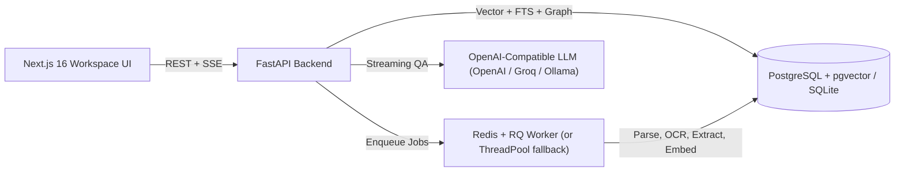

# Veridocs

Document intelligence workspace combining section-aware parsing, hybrid vector/full-text search, claim-level citation verification, contract comparison, anomaly checks, knowledge graphs, and cited report export.


## Key Features

- **Multi-Format Ingestion**: Parses digital and scanned PDFs (`pymupdf`/`pypdf` + `rapidocr`, plus optional `docling`), `.docx` (`python-docx`), `.doc` (via headless LibreOffice), `.png`/`.jpg`/`.tiff` images converted to PDF, and UTF-8 `.txt` files. Legacy `.doc` conversion and `.docx` → PDF viewer rendering use headless LibreOffice (`soffice`), included in `backend/Dockerfile` and verified end-to-end in Docker.
- **Section-Level Citations & Viewer**: Tracks hierarchical headings (`section_path`, e.g., `3 > 3.1 Payment Terms`) per chunk, renders PDFs (including LibreOffice-converted `.docx`/`.doc` files) alongside a paginated text viewer fallback when LibreOffice is absent, and jumps to cited pages.
- **Hybrid Retrieval & Cross-Document Search**: Fuses Fastembed dense cosine search (`BAAI/bge-small-en-v1.5`) with full-text sparse ranking via Reciprocal Rank Fusion (`pgvector` HNSW + PostgreSQL `GIN` or SQLite local fallback) across either a workspace session or the entire document library (`POST /api/search`). PostgreSQL `pgvector` paths are verified in Docker Compose and configured for CI (`CI=true`); local unit tests default to SQLite when no Postgres server is targeted.
- **Two-Stage Citation Grounding Check**: Splits generated answers into factual claims, matches candidate chunks via lexical overlap, and runs contradiction/entailment verification (deterministic heuristic engine by default; optional batched `CrossEncoder` inference when `NLI_ENABLED=true`), surfacing claim support scores and low-confidence OCR/vision warnings in the Verification Drawer.
- **Structured Extraction, Anomaly Flags & Knowledge Graph**: Extracts typed schemas (`invoice`, `contract`, `research_paper`, `resume`) wrapped in verbatim-verified `FieldEvidence`, flags invoice math/date/threshold/metadata anomalies, and builds canonicalized entity-relationship graphs queried alongside vector search.
- **Contract Clause Comparison**: Segments contract clauses, aligns sections via cosine similarity + `scipy.optimize.linear_sum_assignment`, computes token-level word diffs, and exports Markdown redline summaries.
- **Structured Summaries, Risk Reports & Analytics**: Generates cached map-reduce summaries verified by `check_citations` (`POST /api/documents/{id}/summary`), builds cited risk reports exportable as Markdown, PDF (`reportlab`), or DOCX (`python-docx`), and tracks upload/query/flag metrics (`GET /api/analytics`).

## Architecture



See [docs/ARCHITECTURE.md](docs/ARCHITECTURE.md) for the full pipeline specification, and specialized notes in [docs/EXTRACTION.md](docs/EXTRACTION.md), [docs/COMPARISON.md](docs/COMPARISON.md), and [docs/GRAPH.md](docs/GRAPH.md).

## Tech Stack

- **Backend**: Python 3.11, FastAPI, SQLAlchemy 2.x, Alembic, PostgreSQL 16 + `pgvector`, Redis + RQ, `fastembed` (`BAAI/bge-small-en-v1.5`), `pypdf`/`pymupdf`, `python-docx`, `rapidocr-onnxruntime`, `rapidfuzz`, `scipy`, `reportlab`.
- **Frontend**: Next.js 16 (React 19, TypeScript), Tailwind CSS, Zustand, `pdfjs-dist`, `lucide-react`, `react-markdown`, `react-dropzone`.
- **Tooling & Testing**: `pytest`, `vitest`, `ruff`, `mypy`, `eslint`, `tsc`.

## Quickstart

### 1. Docker Compose (Full Stack)

```bash
cp .env.example .env
# Edit .env to supply LLM_API_KEY / OPENAI_API_KEY / GROQ_API_KEY (or configure OLLAMA_BASE_URL)
docker compose up --build
```

Services started:
- Web UI: `http://localhost:3000`
- FastAPI Backend & OpenAPI docs: `http://localhost:8000` (`/docs`)
- PostgreSQL + `pgvector`: port `5432`
- Redis + RQ worker (`veridocs-worker`)

### 2. Local Development (SQLite + In-Process Worker Fallback)

Backend:
```bash
python3 -m venv .venv
source .venv/bin/activate
pip install -r requirements.txt
cp .env.example .env
# Optional: leave DATABASE_URL unset or set sqlite:///backend/data/veridocs.db for local dev
alembic upgrade head
cd backend && uvicorn main:app --host 0.0.0.0 --port 8000 --reload
```

Frontend (in a second terminal):
```bash
npm install
npm run dev
```

### Environment Variables

| Variable | Default | Purpose |
| :--- | :--- | :--- |
| `DATABASE_URL` | `sqlite:///backend/data/veridocs.db` | PostgreSQL (`pgvector`) or SQLite database connection string |
| `REDIS_URL` | `redis://localhost:6379/0` | Redis URL for RQ queue and status pub/sub (falls back to in-process threadpool) |
| `PARSER_BACKEND` | `docling` | Primary PDF parser (`docling` falls back to `pymupdf`/`pypdf` if uninstalled) |
| `OCR_FALLBACK` | `true` | Enables RapidOCR on scanned pages or images below `OCR_TEXT_LAYER_MIN_CHARS` |
| `NLI_ENABLED` | `false` | Enables CrossEncoder model (`NLI_MODEL`) instead of heuristic NLI screen |
| `VISION_ENABLED` | `false` | Enables multimodal page vision analysis for flagged figures/signatures |
| `FLAGS_ENABLED` | `true` | Runs deterministic anomaly checks during ingestion |
| `LLM_BASE_URL` / `LLM_API_KEY` / `LLM_MODEL` | unset | Universal OpenAI-compatible provider config (or `OPENAI_API_KEY`, `GROQ_API_KEY`, `OLLAMA_BASE_URL`) |
| `NEXT_PUBLIC_API_URL` | `http://localhost:8000` | Backend base URL used by the Next.js frontend |

## Usage

1. Open `http://localhost:3000` (a sample agreement is seeded into `demo-session` on startup) or drag/drop `.pdf`, `.docx`, `.doc` (requires LibreOffice in Docker/PATH), `.png`, `.jpg`, `.tiff`, or `.txt` files.
2. Wait for background status stages (`queued -> parsing -> ocr -> chunking -> extraction -> embedding -> ready`).
3. Ask questions in the chat panel or use the header search bar (`POST /api/search`) for cross-document lookup; click inline `[N]` badges to jump to the cited page and inspect claim verification scores.
4. Open the sidebar tabs to inspect Tables, Entities, Fields (with editable overrides and math checks), Summary, Report (MD/PDF/DOCX export), Compare (clause redlines), Flags, and Graph, or click **Dashboard** for workspace metrics.

## API Overview

Full OpenAPI-generated reference: [docs/API.md](docs/API.md). Core endpoints:

- `POST /api/documents/upload`, `GET /api/documents/{id}/status`, `GET /api/documents/{id}/events`
- `GET /api/documents/{id}/tables|entities|extraction|flags`, `PATCH /api/documents/{id}/extraction`
- `POST /api/documents/{id}/summary`, `GET /api/documents/{id}/summary`
- `POST /api/documents/{id}/report`, `GET /api/documents/{id}/report/export?format=md|pdf|docx`
- `POST /api/query`, `POST /api/query/stream`, `POST /api/search`
- `POST /api/comparisons`, `GET /api/comparisons/{id}/export`
- `GET /api/graph`, `GET /api/analytics`, `GET /api/health`

## Evaluation & Performance

Reproducible offline benchmark and evaluation numbers:

| Suite | Command | Measured Result |
| :--- | :--- | :--- |
| Ingestion & OCR | `.venv/bin/python evals/ingestion_eval.py` | 11/11 fixtures: 100.0% char accuracy, 100.0% table accuracy (6 text, 5 OCR) |
| Hybrid Retrieval | `.venv/bin/python evals/retrieval_eval.py` | Held-out (10 queries / 20 chunks): Recall@5 = 100.0%, MRR = 1.000 |
| Claim Verification | `.venv/bin/python evals/verification_eval.py` | Held-out (30 pairs): Accuracy = 83.3%, Support F1 = 90.9%, Contradiction catch = 60.0% |
| Extraction & Entities | `.venv/bin/python evals/extraction_eval.py` | Held-out (5 docs): DocType = 100.0%, Quote Verified = 100.0%, Entity F1 = 77.8% |
| Contract Comparison | `.venv/bin/python evals/comparison_eval.py` | Held-out (2 pairs): Change Detection F1 = 100.0%, Risk Agreement = 100.0% |
| Anomaly Flags | `.venv/bin/python evals/flags_eval.py` | Held-out (20 invoices): Clean FPR = 0.0%, Avg Rule F1 = 75.0% |
| Knowledge Graph | `.venv/bin/python evals/graph_eval.py` | Held-out (2 contracts): Entity Resolution = 100.0%, Edge F1 = 100.0% |

Full methodology and caveats are in [docs/EVALUATION.md](docs/EVALUATION.md) and latency/memory measurements are in [docs/PERFORMANCE.md](docs/PERFORMANCE.md).

## Project Structure

```text
├── backend/
│   ├── alembic/              # Database schema migrations (001..008)
│   ├── classification/       # Heuristic & LLM document classifier
│   ├── comparison/           # Clause segmentation, Hungarian aligner, word diffing
│   ├── entities/             # Regex/heuristic NER extractor
│   ├── extraction/           # Typed schemas (FieldEvidence) & verification checks
│   ├── flags/                # Invoice/contract anomaly checkers
│   ├── graph/                # Canonical entity resolution, graph builder, QA router
│   ├── ingestion/            # Magic-byte validation, Docling/PyMuPDF/DOCX/OCR parsers
│   ├── routers/              # FastAPI endpoints (documents, query, comparisons, graph, analytics, system)
│   ├── tests/                # Pytest test suite (82 tests)
│   ├── Dockerfile
│   ├── main.py               # FastAPI entrypoint & lifespan setup
│   ├── verification.py       # Citation extractor & two-stage claim verifier
│   └── worker.py             # RQ background worker entrypoint
├── components/               # Next.js React components (workspace, chat, upload, pdf-viewer)
├── docs/                     # Architecture, OpenAPI reference, evaluation, performance docs
├── evals/                    # Reproducible domain evaluation benchmarks
├── lib/                      # Typed API client & Zustand store
├── scripts/                  # Fixture generator, SQLite->PG migration, benchmark runner
├── tests/                    # Frontend Vitest suite (14 tests) & shared fixtures
├── docker-compose.yml
├── Makefile                  # lint, test, build, clean targets
└── pyproject.toml            # Ruff & mypy configuration
```

## Testing & Linting

```bash
make lint    # ruff check + mypy backend + eslint + tsc --noEmit
make test    # 82 backend pytest tests + 14 frontend vitest tests
make build   # Production Next.js webpack build
```

## Known Limitations

- **Verified Live vs. Local Scope**:
  - Clean `docker compose down -v && up --build` has been verified live against PostgreSQL 16 + `pgvector`, Redis/RQ, Next.js (`http://localhost:3000`), headless LibreOffice (`soffice`), and RapidOCR across PDF, `.docx`, `.doc`, and scanned PDF uploads, Q&A, Map-Reduce Summary, Report generation & export (`md`, `pdf`, `docx`), Analytics Dashboard, and cross-document search.
  - Because `make test` runs against SQLite by default locally, PostgreSQL CI (`backend-postgres-pgvector-tests`) runs on push/PR in GitHub Actions; interactive browser UI click-through has not been automated with Playwright.
- **CPU Embedding Throughput**: Without a GPU, `BAAI/bge-small-en-v1.5` ONNX CPU inference accounts for ~85% of multi-page PDF ingestion latency (~8.5s median end-to-end for a 50-page digital PDF locally).
- **Verification Model Defaults**: `NLI_ENABLED` defaults to `false` to avoid downloading/running a cross-encoder model at runtime; subtle semantic paraphrases and implicit contradictions scored only by the heuristic engine show 60.0% contradiction catch rate on the held-out eval split.
- **Offline Fallback Mode**: Without an external LLM API key configured, summarization, comparison explanations, and schema extraction fall back to deterministic heuristics.

## Roadmap

- Add Playwright browser integration tests against the Docker Compose stack.
- Support optional quantized GPU/CoreML ONNX execution providers for faster bulk ingestion.
- Extend `evals/` coverage from synthetic fixtures to multi-hundred-page public contract corpora.
