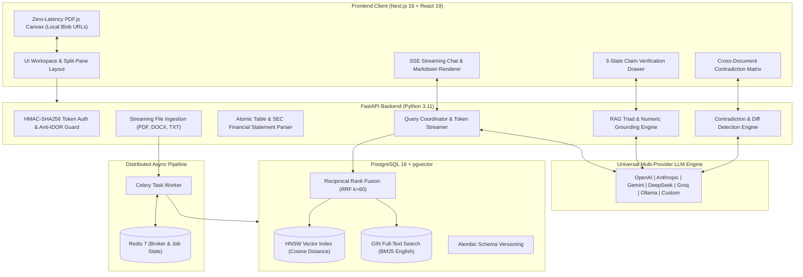

# 📑 Veridocs — Enterprise Document Intelligence & Verification Engine

Veridocs is an enterprise-grade AI document intelligence platform that enables multi-file question answering, precise page citations with instant coordinate highlights, cross-document contradiction auditing, and RAG Triad grounding verification.

🌐 **[Live Demo](https://veridocs17.vercel.app/)** | 📦 **[GitHub Repository](https://github.com/Spidey173/Veridocs)**

---

## 🏗️ System Architecture



---

## ⚡ Core Capabilities

- **Zero-Latency PDF.js Canvas**: Multi-page PDF viewer with client-side Blob URL rendering and smooth citation coordinate jumps.
- **Reciprocal Rank Fusion (RRF) Hybrid Search**: Merges PostgreSQL `pgvector` HNSW dense vector cosine distance (`<=>`) with sparse BM25 full-text search (`ts_rank_cd`) inside database CTEs in $< 15\text{ms}$.
- **Atomic Table & Financial Statement Parsing**: Preserves borderless SEC 10-K balance sheets, income statements, and multi-page tables as indivisible semantic units without splitting cells across chunk boundaries.
- **RAG Triad Grounding Verification**: Evaluates Context Relevance, Groundedness, Answer Relevance, and Numeric Accuracy for every synthesized answer.
- **Cross-Document Contradiction Engine**: Identifies numerical mismatches, clause conflicts, and temporal discrepancies across multiple documents side-by-side.
- **Universal Multi-Provider LLM Hub**: Dynamic zero-lockin architecture. Veridocs auto-detects whichever provider key is configured or connects to local private Ollama instances.
- **Distributed Async Processing**: Background ingestion of massive multi-hundred page filings using Celery workers, Redis queues, and Anti-IDOR ownership isolation.

---

## 🤖 Universal LLM Provider Configuration

Veridocs does **not** force any default LLM. It automatically detects and binds to whichever provider you configure in `.env`:

| Provider | Environment Variable | Default Model | Description |
| :--- | :--- | :--- | :--- |
| **OpenAI** | `OPENAI_API_KEY` | `gpt-4o-mini` | Fast, accurate general-purpose reasoning |
| **Anthropic** | `ANTHROPIC_API_KEY` | `claude-3-5-haiku-20241022` | Deep analytical parsing and long-context synthesis |
| **Google Gemini** | `GOOGLE_API_KEY` | `gemini-2.5-flash` | Low latency with multimodal vision fallback |
| **DeepSeek** | `DEEPSEEK_API_KEY` | `deepseek-chat` | Cost-effective mathematical & code reasoning |
| **Groq** | `GROQ_API_KEY` | `llama-3.3-70b-versatile` | Ultra-fast LPU inference (500+ tokens/sec) |
| **Local Ollama** | `OLLAMA_BASE_URL` | `llama3.2` | 100% private, free, runs offline on your machine |
| **Mistral AI** | `MISTRAL_API_KEY` | `mistral-small-latest` | Multilingual European open-weights model |
| **OpenRouter** | `OPENROUTER_API_KEY` | User configured | Unified gateway for hundreds of open & closed models |
| **GitHub Models**| `GITHUB_TOKEN` | `gpt-4o-mini` | Free developer tier models via GitHub Marketplace |
| **Self-Hosted** | `LLM_BASE_URL` | User configured | Any OpenAI-compatible endpoint (vLLM, TGI, LM Studio) |

To explicitly lock to a specific provider, set `LLM_PROVIDER`:
```bash
LLM_PROVIDER=groq  # or 'openai', 'anthropic', 'google', 'ollama', etc.
```

---

## 🚀 Quickstart

### Option A: Unified Local Runner

Run both the FastAPI backend and Next.js frontend with one script:

```bash
./run.sh
```

- Frontend: `http://localhost:3000`
- Backend API & Interactive Docs: `http://localhost:8000/docs`

---

### Option B: Docker Compose (Full-Stack Production)

Spins up PostgreSQL 16 with `pgvector`, Redis 7, the FastAPI API, the Celery async worker, and the Next.js production runner:

```bash
docker compose up -d --build
```

#### Service Endpoints:
- **Web Client**: `http://localhost:3000`
- **FastAPI API**: `http://localhost:8000`
- **PostgreSQL**: `localhost:5432` (`veridocs` / `veridocs_password`)
- **Redis Broker**: `localhost:6379`
- **Healthcheck Probe**: `curl http://localhost:8000/api/health`

---

### Option C: Manual Setup

#### 1. Backend Setup
```bash
cd backend
python -m venv .venv
source .venv/bin/activate
pip install -r requirements.txt

# Configure environment
cp .env.example .env

# Run database migrations
alembic upgrade head

# Start FastAPI ASGI server
uvicorn main:app --host 0.0.0.0 --port 8000 --reload
```

#### 2. Frontend Setup
```bash
cd frontend
npm install
npm run dev
```

---

## 🗄️ Database & Alembic Migrations

Veridocs uses PostgreSQL 16 with the `pgvector` extension for hybrid vector search.

```bash
# Apply migrations to head
cd backend
alembic upgrade head

# Create a new versioned migration after model changes
alembic revision --autogenerate -m "describe_schema_change"

# Rollback last migration
alembic downgrade -1
```

*Note: In development and test modes without a running PostgreSQL instance, Veridocs automatically falls back to lightweight in-memory vector storage.*

---

## 🧪 Testing Suite

### 1. Backend Pytest Suite (Unit, Integration, & Security)
The backend contains 151 automated unit, integration, and security tests covering RRF hybrid search, anti-IDOR authorization, async tasks, and RAG Triad grounding:

```bash
# Run all tests with coverage
pytest backend/tests --cov=backend --cov-report=term-missing
```

### 2. Frontend Playwright E2E Suite
The frontend includes 16 Playwright end-to-end tests covering real browser rendering, drag-and-drop ingestion, SSE token streaming, contradiction audits, and claim drawers:

```bash
cd frontend

# Run all Playwright E2E tests headless
npm run test:e2e

# Run Playwright with interactive visual UI
npm run test:e2e:headed

# Run live unmocked backend smoke test
npm run test:e2e:smoke
```

---

## 🔒 Security Architecture

- **Path Traversal Protection**: Uploaded files are assigned random UUIDs on disk, decoupling user filenames from the filesystem.
- **Anti-IDOR / Multi-Tenant Isolation**: Every session, document, and background job checks `owner_id` against the authenticated JWT context.
- **SQL Injection Immunity**: 100% of database interactions use parameterized positional queries (`$1, $2, ...`) via `asyncpg`.
- **Restricted Secrets**: Dev secrets are isolated with `0o600` file permissions outside public/upload directories.
- **Build Isolation**: Container builds utilize strict `.dockerignore` files preventing credential leakage.

---

## 📄 License

Distributed under the MIT License.
