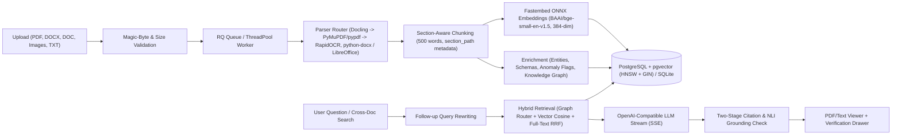

# Veridocs Architecture

Veridocs is a full-stack document intelligence workspace built on Next.js, FastAPI, PostgreSQL (`pgvector`), and Redis/RQ (with an in-process SQLite + threadpool fallback for standalone local runs).

## End-to-End Data Flow

## Pipeline Stages

### 1. Ingestion & Parsing (`backend/ingestion/`)

- **Validation (`router.py`)**: Checks extension allowlist, streams uploads up to `MAX_FILE_SIZE_MB`, rejects `.doc` cleanly if LibreOffice is unavailable, and verifies magic bytes (`%PDF`, ZIP + `[Content_Types].xml`/`word/` for `.docx`, PNG/JPEG/TIFF headers, plain UTF-8 for `.txt`).
- **Format Extraction**:
  - **PDF**: `docling_backend.py` (when installed) or `pymupdf_backend.py` (PyMuPDF `fitz` with `pypdf` fallback). Pages whose extracted text is below `OCR_TEXT_LAYER_MIN_CHARS` trigger `RapidOCR` when `OCR_FALLBACK=true`.
  - **DOCX / DOC**: `docx_backend.py` parses paragraphs, heading styles (`Heading 1..4`), and tables via `python-docx`. When LibreOffice headless (`soffice`) is present, `.doc` files are converted to `.docx`/`.pdf` and `.docx` files render as paginated PDFs in the viewer; otherwise the workspace falls back to paginated text rendering via `/documents/{session_id}/text`.
  - **Images**: PNG/JPG/TIFF files are converted to single-page PDFs with ReportLab (`convert_image_to_pdf`) and processed through `RapidOCR`.

### 2. Chunking & Section Hierarchy (`backend/pdf_processor.py`, `backend/ingestion/headings.py`)

- Document structure headings are tracked hierarchically to attach `section_path` metadata (for example, `3 > 3.1 Payment Terms`) to every `chunks` row.
- Narrative passages and Markdown/JSON tables are segmented into chunks carrying `filename`, `page_number`, `chunk_type`, `extraction_method`, `ocr_confidence`, and `section_path`.

### 3. Dense Embeddings & Storage (`backend/tasks.py`, `backend/database.py`, `backend/models_db.py`)

- `ModelRegistry.embedding_model` loads `BAAI/bge-small-en-v1.5` (384-dim) via `fastembed` once at server startup and embeds chunks in batches (`batch_size=32`).
- PostgreSQL persists embeddings in a `pgvector` `Vector(384)` column indexed with HNSW (`m=16, ef_construction=64`), paired with `GIN` full-text indexes on `content`. Local test/dev runs without PostgreSQL store float32 vectors in SQLite.

### 4. Hybrid Retrieval (`backend/vector_store.py`, `backend/graph/router.py`)

- Multi-turn follow-ups are rewritten into standalone queries (`rewrite_query_for_retrieval`).
- `GraphQARouter` inspects the session knowledge graph (`graph_nodes`, `graph_edges`) when structural or relationship queries are detected.
- `VectorStore.search()` runs dense cosine similarity and sparse full-text search (PostgreSQL SQL `ts_rank` or in-memory token overlap), merges both ranked lists via Reciprocal Rank Fusion (`k=60`), and serves repeated identical queries from a version-invalidated retrieval cache (`_SEARCH_CACHE`).

### 5. Generation & Grounding Verification (`backend/llm_service.py`, `backend/verification.py`)

- Responses stream over Server-Sent Events (`/api/query/stream`) using pooled OpenAI-compatible clients (`OpenAI`, Groq, Ollama, or custom `X-LLM-*` headers).
- Post-generation, `extract_citations_from_answer()` maps `[N]` markers to retrieved chunks (`page`, `section_path`, `source_file`).
- `check_citations()` splits factual claims, runs a pre-tokenized lexical overlap screen (`Stage 1`), and evaluates entailment/contradiction (`Stage 2`) using deterministic rules (numeric mismatches, negation flips, antonym pairs) or batched `CrossEncoder` inference when `NLI_ENABLED=true`. Claims grounded on low-confidence OCR (`ocr_confidence < 0.6`) or vision-only excerpts emit explicit UI warnings.

### 6. Structured Enrichment, Summaries & Reports

- **Extraction & Entities (`backend/entities/`, `backend/extraction/`)**: Classifies document type (`invoice`, `contract`, `research_paper`, `resume`, `other`), extracts entities and typed fields wrapped in `FieldEvidence`, and enforces verbatim quote verification plus invoice arithmetic checks.
- **Anomaly Flags (`backend/flags/`)**: Deterministic heuristic checkers for invoice math mismatches, date inconsistencies, round/threshold amounts, duplicate invoice numbers, and suspicious PDF metadata.
- **Knowledge Graph (`backend/graph/`)**: Resolves entity aliases via suffix normalization and RapidFuzz token matching (`>= 88`) into canonical nodes and verified relational edges.
- **Clause Comparison (`backend/comparison/`)**: Segments contract clauses, computes 384-dim clause embeddings, solves optimal alignment via `scipy.optimize.linear_sum_assignment`, and exports Markdown diffs.
- **Summaries & Reports (`backend/summarizer.py`, `backend/report_generator.py`)**: Background jobs produce cached `document_summaries` (map-reduce JSON verified by `check_citations`) and `document_reports` exportable to Markdown, PDF (`reportlab`), and DOCX (`python-docx`).

