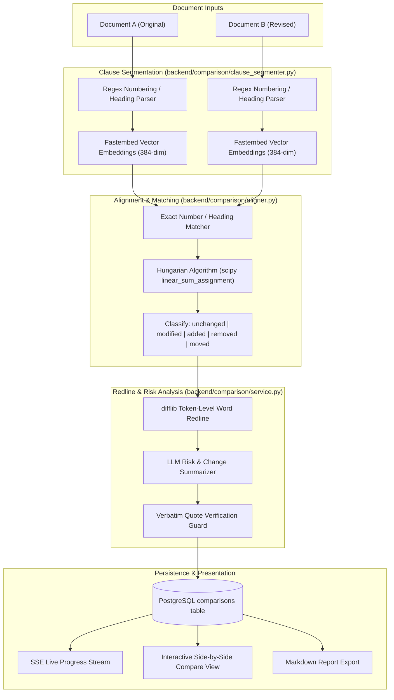

# Contract Comparison & Clause-Level Redline Engine

Veridocs includes a deterministic, clause-level contract comparison and redline diff engine designed for legal and financial review. It pairs structural document segmentation with vector similarity, the Hungarian matching algorithm, tokenized word-level diffing, and LLM-powered legal risk summarization.

---

## Architecture & Pipeline



---

## 1. Clause Segmentation (`backend/comparison/clause_segmenter.py`)

Contract text is partitioned into semantically discrete clauses using a multi-pattern regex engine, falling back to LLM segmentation when document hierarchy is non-standard.

### Detection Patterns
- **Numbered clauses**: `1.`, `1.1`, `1.1.1`, `1.1(a)`
- **Formal articles & sections**: `ARTICLE I`, `Section 2.0`, `CLAUSE 4`
- **Parenthetical lettering**: `(a)`, `(b)`, `(iv)`
- **All-caps legal headings**: `INDEMNIFICATION`, `GOVERNING LAW`, `TERM AND TERMINATION`

Each clause extracts:
- `clause_index`: Integer ordering within the document.
- `number`: Formatted heading identifier (e.g., `"Section 4.1"`).
- `heading`: Title text of the clause.
- `text`: Complete clause body.
- `page_start`, `page_end`: Page number bounds for click-to-page navigation.
- `embedding`: 384-dimensional dense vector computed via Fastembed (`bge-small-en-v1.5`).

---

## 2. Clause Alignment Algorithm (`backend/comparison/aligner.py`)

Aligning clauses between different drafts or amended versions of a contract requires handling renumbered sections, renamed headings, inserted clauses, and reorganized text.

1. **Exact Identifier Matching**:
   Clauses sharing identical numbers and highly similar heading text ($\text{similarity} \ge 0.85$) are matched directly.
2. **Global Optimal Assignment via Hungarian Algorithm**:
   For remaining unaligned clauses, an $M \times N$ cosine distance cost matrix is constructed using the 384-dimensional clause embeddings:
   $$C_{i,j} = 1 - \frac{u_i \cdot v_j}{\|u_i\|_2 \|v_j\|_2}$$
   The optimal bipartite matching is solved in polynomial time via `scipy.optimize.linear_sum_assignment`:
   $$\min_{\pi} \sum_{i} C_{i, \pi(i)}$$
   Pairs with cosine similarity $\ge 0.60$ are accepted as aligned clauses.
3. **Classification**:
   - **`unchanged`**: Word diff ratio $= 1.0$ and identical positions.
   - **`modified`**: Aligned clauses with word diff ratio $< 1.0$.
   - **`moved`**: Aligned clauses whose relative order or numbering shifted.
   - **`added`**: Clauses present in Document B with no counterpart in Document A.
   - **`removed`**: Clauses present in Document A with no counterpart in Document B.

---

## 3. Word-Level Redline Diffing

For all `modified` and `moved` clauses, fine-grained word-level differences are computed using `difflib.SequenceMatcher`:
- **`insert`**: Words added in Document B (styled in green with `+` annotations).
- **`delete`**: Words removed from Document A (styled in red with strikethrough).
- **`equal`**: Unaltered context words.

---

## 4. LLM Legal Risk Summarization & Quote Verification

For each modified clause, the system generates a structured risk assessment:
```json
{
  "change_type": "financial | liability | term | termination | confidentiality | governing_law | other",
  "summary": "Liability cap was increased from $1,000,000 to $5,000,000 and gross negligence carve-outs were expanded.",
  "risk": "low | medium | high",
  "risk_reason": "Materially increases financial exposure under breach of contract claims."
}
```

### Verbatim Quote Guard
Every summary is validated against the source clauses: any direct quotations included in `summary` or `risk_reason` must exist verbatim in Document A or Document B. Citations to both `page_a` and `page_b` are validated before persisting.

---

## 5. API Endpoints

| Method | Endpoint | Description |
| :--- | :--- | :--- |
| `POST` | `/comparisons` | Initiates background contract comparison (`{doc_a, doc_b}`). Returns job ID. |
| `GET` | `/comparisons/{id}` | Fetches full comparison payload including aligned clauses, redlines, and risk summaries. |
| `GET` | `/comparisons/{id}/events` | SSE stream providing real-time stage progress updates (`parsing -> aligning -> diffing -> summarizing -> ready`). |
| `GET` | `/comparisons/{id}/export` | Generates downloadable Markdown executive summary and clause-level redline report. |

---

## 6. Frontend Compare Viewer (`components/workspace/CompareViewer.tsx`)

The web UI provides a dedicated side-by-side contract comparison experience:
- **Two Document Pickers**: Independent dropdown selectors for Version A and Version B.
- **Risk Severity Filter**: Filter differences by risk level (`All`, `High`, `Medium`, `Low`).
- **Change Type Filter**: Filter by legal domain (`All`, `financial`, `liability`, `termination`, etc.).
- **Interactive Redlines**: Side-by-side or stacked clause comparison with color-coded token highlights.
- **Click-to-Page Navigation**: Clicking a clause header jumps the PDF viewer directly to that clause's exact page in the document.
- **One-Click Export**: Export comparison reports to Markdown format.
