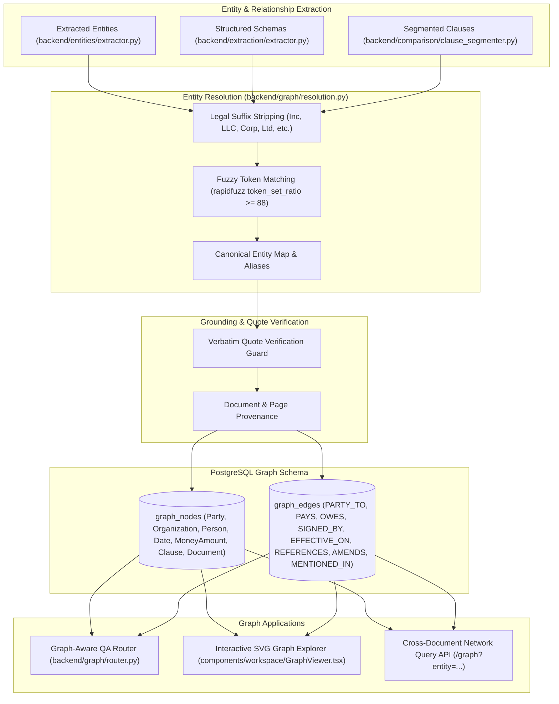

# Knowledge Graph & Graph-Aware Document Intelligence

Veridocs extracts relational entities and legal structures into an in-process document knowledge graph stored in PostgreSQL. The knowledge graph powers cross-document entity exploration, corporate relationship tracking, and hybrid graph-aware question answering.

---

## Architecture & Pipeline



---

## 1. Graph Ontology

### Node Types
| Node Type | Description | Example Properties |
| :--- | :--- | :--- |
| `Party` | Contracting entities and organizations | `name`, `canonical_name`, `entity_type: "party"` |
| `Organization` | Companies, vendors, institutions | `name`, `canonical_name`, `entity_type: "organization"` |
| `Person` | Individuals, signatories, officers | `name`, `title`, `entity_type: "person"` |
| `Date` | Execution dates, effective dates, milestones | `value` (ISO 8601), `raw_text` |
| `MoneyAmount` | Consideration, fees, liabilities, payment values | `amount` (float), `currency` (ISO 4217) |
| `Clause` | Legal sections and contractual covenants | `number`, `heading`, `clause_type` |
| `Document` | Container document node | `filename`, `doc_type`, `page_count` |

### Edge Types
| Edge Type | Source Node | Target Node | Semantics |
| :--- | :--- | :--- | :--- |
| `PARTY_TO` | `Party` / `Organization` | `Document` | Entity is a named principal party to the agreement |
| `PAYS` | `Party` / `Organization` | `MoneyAmount` | Entity is obligated to make payment |
| `OWES` | `Party` / `Organization` | `Party` | Debtor owes creditor consideration |
| `SIGNED_BY` | `Document` / `Clause` | `Person` | Document was executed by the individual |
| `EFFECTIVE_ON` | `Document` / `Clause` | `Date` | Date on which terms become legally binding |
| `REFERENCES` | `Clause` / `Document` | `Document` / `Clause` | Explicit textual citation to another instrument |
| `AMENDS` | `Document` / `Clause` | `Document` / `Clause` | Modification or addendum to prior terms |
| `MENTIONED_IN` | Any Node | `Document` | Entity or fact mentioned in document text |

---

## 2. Entity Resolution & Canonicalization (`backend/graph/resolution.py`)

Legal documents frequently refer to identical corporate entities by different variations, abbreviations, or legal forms (e.g., *"Acme Technologies, Inc."*, *"Acme Technologies Inc"*, *"Acme Tech LLC"*, *"Acme"*).

### Resolution Pipeline:
1. **Legal Suffix Normalization**:
   Strips common legal suffixes (`Inc.`, `Incorporated`, `LLC`, `L.L.C.`, `Corp.`, `Corporation`, `Ltd.`, `Limited`, `Co.`, `Company`, `Group`, `Holdings`, `LP`, `LLP`, `P.C.`, `S.A.`, `A.G.`, `GmbH`).
2. **Whitespace & Punctuation Cleanup**:
   Removes commas, periods, trailing hyphens, and normalizes multi-spaces.
3. **Fuzzy Token Matching**:
   Uses `rapidfuzz.fuzz.token_set_ratio` with an empirical threshold of $\ge 88$. If tokens match above threshold, the entities are merged into a single canonical node.
4. **Alias Tracking**:
   The canonical node preserves an array of all observed text variations (`aliases: ["Acme Corp", "Acme Corporation", "Acme"]`) for search indexing.

---

## 3. Relational Quote Verification Guard

Every edge connecting entities to documents or clauses carries mandatory provenance:
- `page_number`: Exact document page where the relationship is stated.
- `evidence_quote`: Verbatim excerpt containing the relationship.
- `verification_status`: Deterministically validated against the underlying document page text. If the quote is missing or hallucinated, the edge is marked `unverified`.

---

## 4. Graph-Aware Question Answering (`backend/graph/router.py`)

Veridocs dynamically detects relational questions and injects structured graph facts into the retrieval pipeline before performing vector search.

### Query Intent Routing
The `GraphQARouter` analyzes incoming questions for relational keywords:
- **Parties**: *"Who are the parties to...", "Who is involved in...", "Which companies signed..."*
- **Signatories**: *"Who signed...", "Who is the signatory for..."*
- **Financial Obligations**: *"How much does X owe...", "What does Y pay for...", "Who pays..."*
- **Dates & Milestones**: *"When is the effective date...", "When does the agreement terminate..."*
- **Amendments**: *"What documents amend...", "Does this contract reference..."*

### Graph Context Synthesis
When relational intent is detected:
1. The graph is queried for connected subgraphs matching the target entities.
2. Retrieved graph facts are formatted into high-density natural language assertions:
   ```
   [Knowledge Graph Fact] Acme Corp is PARTY_TO SaaS Master Services Agreement.
   [Knowledge Graph Fact] Jane Doe (VP Engineering) SIGNED_BY SaaS Master Services Agreement (Page 4).
   [Knowledge Graph Fact] Acme Corp PAYS $120,000.00 USD (Page 2).
   ```
3. These factual chunks are prioritized alongside dense pgvector and sparse BM25 chunks in the LLM context prompt.
4. The system reports `retrieval_strategy: "graph"` in both the JSON response and the streaming SSE metadata event.

---

## 5. API Endpoints

| Method | Endpoint | Description |
| :--- | :--- | :--- |
| `GET` | `/documents/{id}/graph` | Retrieves graph nodes, edges, entity counts, and statistics for a specific document. |
| `GET` | `/graph?entity=...` | Cross-document entity search. Returns multi-document network subgraphs centered on the requested entity. |

---

## 6. Frontend Graph Explorer (`components/workspace/GraphViewer.tsx`)

The web UI provides a clean, responsive SVG graph visualization:
- **Responsive SVG Canvas**: Dynamic layout rendering nodes with distinct colors by node type (`Party` = blue, `Person` = violet, `Money` = green, `Date` = amber).
- **Safety Node Cap Notice**: For large documents, the visualizer caps rendering to the top 50 most connected nodes to maintain 60 FPS performance, displaying a clear advisory banner.
- **Interactive Search Filter**: Instant client-side entity filtering with autocomplete.
- **Node Alias Inspector**: Clicking any node opens a drawer displaying its canonical name, observed text aliases, connected documents, and degree centrality.
- **Edge Click-to-Page Navigation**: Clicking any relationship edge jumps the PDF canvas viewer directly to the exact page and clause where the relationship is established.
